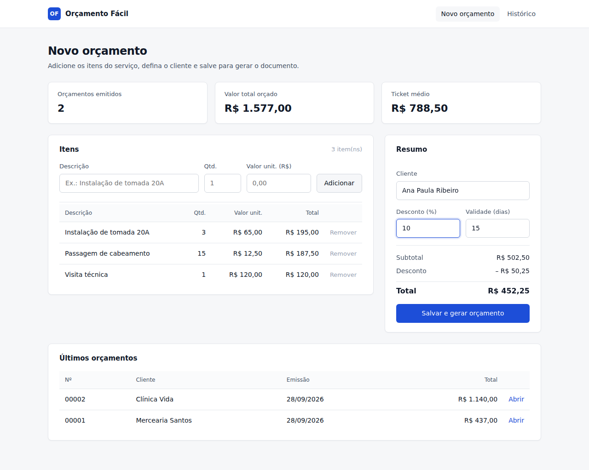
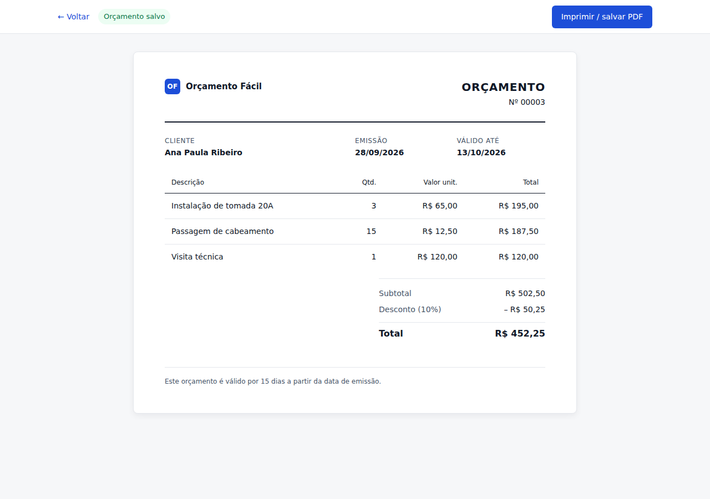

# Orçamento Fácil

Sistema web para emissão de orçamentos voltado a pequenos prestadores de serviço. Desenvolvido em **PHP 8 puro com SQLite**, sem frameworks e sem dependências externas.



## Funcionalidades

- Montagem do orçamento item a item, com cálculo automático de subtotais
- Desconto percentual com atualização do total em tempo real
- Prazo de validade configurável por orçamento
- Documento final formatado para impressão ou exportação em PDF pelo navegador
- Histórico de orçamentos emitidos e indicadores gerais (quantidade, valor total e ticket médio)



## Decisões técnicas

- **SQLite via PDO**: banco em arquivo, criado automaticamente na primeira execução. Não exige instalação de servidor de banco de dados.
- **Consultas parametrizadas** em todas as operações de escrita e leitura, e escape de saída em todo conteúdo exibido.
- **Transação** ao salvar o orçamento e seus itens, garantindo que nenhum orçamento fique gravado pela metade.
- **Separação de responsabilidades**: acesso a dados em `src/banco.php`, formatação e cálculos em `src/helpers.php`, páginas na raiz.
- **CSS de impressão** dedicado, para que o documento saia limpo no papel ou no PDF.

## Estrutura

```
index.php          criação de orçamento e histórico
orcamento.php      visualização do orçamento emitido
src/banco.php      conexão, esquema e consultas
src/helpers.php    formatação de moeda, datas e cálculos
assets/            CSS e JavaScript
```

## Como executar

Requer PHP 8.1 ou superior com a extensão `pdo_sqlite` habilitada.

```bash
php -S localhost:8000
```

Acesse `http://localhost:8000`. O banco é criado em `dados/orcamentos.sqlite` no primeiro acesso.

## Próximos passos

- Cadastro de clientes e de itens recorrentes
- Edição e duplicação de orçamentos
- Status do orçamento (enviado, aprovado, recusado)
